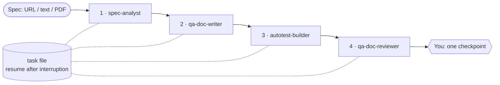

<p align="center">
  
</p>

<h1 align="center">QA Agentic Pipeline</h1>

<p align="center">
  A Claude Code plugin that turns a specification into a reviewed QA package —<br>
  spec gap analysis → risk-based test plan → pyramid-split test cases → autotests in your repo → independent review —<br>
  with exactly one human checkpoint.
</p>

<p align="center">
  <a href="https://github.com/leonovvc/qa-agentic-pipeline/actions/workflows/ci.yml"></a>
  
  
  <a href="LICENSE"></a>
</p>

<p align="center"><a href="README.ru.md">Читать на русском</a></p>

---

## Why

Handing a spec to an LLM and asking for "test cases" reliably produces the same failure
modes: requirements nobody noticed were ambiguous get tested as if they were clear, every
case lands in E2E, boundaries are tested at the middle of the range, generated tests
assert nothing useful, and the model then reviews its own work favourably.

This plugin replaces that single prompt with a small QA team of four agents, each with a
narrow job, a fixed output format, and a stage after it that checks its work:

| Stage | Agent | Produces |
|---|---|---|
| 1 | **spec-analyst** | Numbered requirements inventory, gaps, contradictions, questions for you and for the spec owner, assumptions, security lens — and the spec annotated inline |
| 2 | **qa-doc-writer** | Risk-scored test plan with a traceability matrix; test cases designed with named techniques (BVA, decision tables, state transitions…) and placed at the lowest sufficient pyramid level |
| 3 | **autotest-builder** | Tests in your repository's existing stack and folders, actually run, with honest results — a failing test that found a bug stays failing |
| 4 | **qa-doc-reviewer** | Independent review against the original spec, not the writer's summary of it; Blocking / Major / Minor findings and a separate **Disputed** list for you |



## Highlights

- **Traceability you can count.** Stage 1 numbers every requirement (`REQ-1…n`); every
  case traces to one (`TC-API-004 → REQ-3`); every test title carries its case ID; the
  reviewer reports "*23 of 25 requirements covered*" — and
  [`tools/check_artifacts.py`](tools/check_artifacts.py) verifies it mechanically.
- **Questions go to the right person.** Track A — things you can decide now (asked in the
  moment). Track B — product questions only the spec owner can answer, written as a
  ready-to-forward list, ordered by risk.
- **Risk decides depth.** Impact × probability per requirement → P0–P3 → how many
  techniques and which levels it must get.
- **Security lens.** When a feature touches auth, input, money, personal data or uploads,
  the spec is checked against OWASP Top 10 (2025) questions, and negative security cases
  are designed.
- **Fits your repo.** Stack detection first; extends the existing runner, folders and
  fixtures. Never commits, pushes, or edits product code to make a test pass.
- **English or Russian.** Chosen once per run; identifiers, IDs and file names always stay
  in English.
- **Survives interruptions.** A Jira-style task file is written around every stage — a
  dropped session resumes from the first unfinished stage.

## Quick start

```text
/plugin marketplace add leonovvc/qa-agentic-pipeline
/plugin install qa-agentic-pipeline@leonovvc-qa
```

Check out a branch in the project you want to test, then:

```text
Run the QA pipeline on this spec: https://wiki.example.com/checkout/promo-codes
```

```text
Прогони QA-пайплайн по ТЗ specs/password-reset.md, документация на русском.
```

You get `docs/qa/<task-id>/` with the gap report, annotated spec, test plan, test cases,
autotest summary, review report, and a **checkpoint** listing what needs your decision.
Tests land in your repo's own test directories. If the session drops: *"Resume the QA
pipeline."*

➡ [Getting started](docs/getting-started.md) · [How each stage works](docs/pipeline.md) ·
[Architecture and design decisions](docs/architecture.md) · [Skills catalogue](docs/skills.md)

## Evidence that it works

Three layers, from free and deterministic to real model runs. Details and how to rerun:
[docs/evals.md](docs/evals.md).

| Layer | What it proves | Runs |
|---|---|---|
| **Static validation** — [`validate_plugin.py`](tools/validate_plugin.py) + `claude plugin validate` | Every skill and agent is well-formed; no reference to a skill that isn't shipped; contract and skills agree; attribution in sync | Every push (CI) |
| **Contract checks** — [`check_artifacts.py`](tools/check_artifacts.py) + 42 pytest tests | The checker accepts correct pipeline output (EN and RU golden runs) and rejects each kind of violation: lost requirement, renumbered marker, missing case field, inverted pyramid, unmapped case, unrated finding… | Every push (CI) |
| **Behavioral evals** — `claude plugin eval` suite in [`evals/`](evals) | Real runs of the agents on specs with **planted defects**, graded by regex, tool-use, file and LLM-judge graders | Manual workflow; recorded results in [`eval-results/`](eval-results) |

<!-- EVAL-RESULTS:START -->
**Recorded run — 2026-10-27** ([report](eval-results/2026-10-27/report.html), [artifacts and scores](eval-results/2026-10-27)), one run per case, $3.29 total:

| Case | Grader score | Independent check |
|---|---|---|
| Stage 1 — EN promo spec, 8 planted defects | 0.93 → 1.00 after grader fix ¹ | **8 / 8** defects found · 25 REQs · contract 13/14 ² |
| Stage 1 — RU password reset, security lens | **1.00** | **6 / 6** defects found · contract 14/14 |
| Stage 2 — test design from a gap report | **1.00** | 41 cases, all 6 REQs traced · contract 55/55 |
| Stage 3 — pytest repo with a planted bug (RU) | 0.50 ³ | tests correct, bug reported as product defect; plugin not invoked |
| Stage 4 — review with 4 planted doc defects | **1.00** | all 4 found with citations |
| Resume after an interrupted Stage 3 | 0.78 → 1.00 after grader fix ¹ | stages 1–2 untouched · contract 69/69 |
| Blocks on a spec with no requirements | **1.00** | task `BLOCKED`, no plan written |
| Concept question — no pipeline | **1.00** | no agents, no files |

¹ Grader false negatives found while reading the transcripts (a too-narrow regex; an `input_match` that matched file *content* instead of the path) — fixed in `evals/`; the recorded artifacts show the agents' behaviour was correct.
² The agent logged 20 assumptions but marked none inline in the annotated spec — a real, minor contract deviation the checker caught.
³ **A real defect found by the evals:** asked "make autotests for these cases", Claude wrote correct tests itself instead of dispatching `autotest-builder`, so no `autotest-summary.md` or task-state update. Agent and skill trigger descriptions were fixed in response; re-run pending.
<!-- EVAL-RESULTS:END -->

## Repository layout

```text
.claude-plugin/       plugin.json, marketplace.json
agents/               spec-analyst, qa-doc-writer, autotest-builder, qa-doc-reviewer
skills/               18 skills; run-qa-pipeline/references/artifact-contract.md is the format spec
evals/                claude plugin eval suite: specs with planted defects, fixtures, graders
eval-results/         recorded eval runs: scores, reports, and the artifacts the agents produced
tools/                validate_plugin.py, check_artifacts.py, score_spec_analysis.py
tests/                pytest suite + golden pipeline outputs (EN, RU)
docs/                 architecture, pipeline, skills, getting started, evals
```

## Development

```bash
pip install pyyaml pytest
python tools/validate_plugin.py          # static validation
python -m pytest                         # checker, validator and scorer tests
claude plugin validate .                 # official manifest/skill validation

# behavioral evals (real model calls; needs Claude Code auth; Linux needs bubblewrap + socat)
claude plugin eval . --scaffold --trust-plugin --ablation none --runs 1 \
  --allow-tools Write Edit Bash
```

## Credits

Ten of the eighteen skills are adapted from
[petrkindlmann/qa-skills](https://github.com/petrkindlmann/qa-skills) by Petr Kindlmann
(MIT) and reworked into stage procedures of this pipeline — see
[THIRD_PARTY_NOTICES.md](THIRD_PARTY_NOTICES.md) for what changed in each. The agents,
the orchestration and state layer, the Stage 1/2/4 methodology skills, the artifact
contract, the tooling and the evals are original to this project.

## License

[MIT](LICENSE) © 2026 Vladislav Leonov
