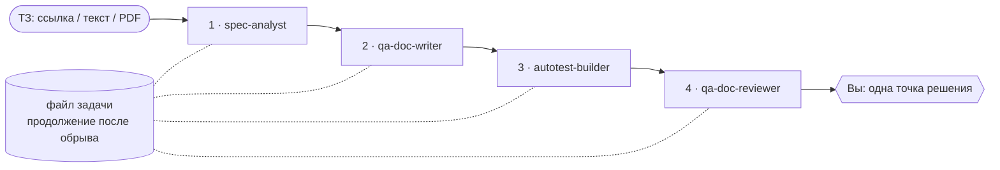

<p align="center">
  
</p>

<h1 align="center">QA Agentic Pipeline</h1>

<p align="center">
  Плагин для Claude Code, который превращает ТЗ в проверенный QA-пакет:<br>
  анализ ТЗ → тест-план на основе рисков → тест-кейсы по уровням пирамиды → автотесты в вашем репозитории → независимое ревью —<br>
  и ровно одна точка решения для человека.
</p>

<p align="center">
  <a href="https://github.com/leonovvc/qa-agentic-pipeline/actions/workflows/ci.yml"></a>
  
  
  <a href="LICENSE"></a>
</p>

<p align="center"><a href="README.md">Read in English</a></p>

---

## Зачем

Если дать LLM техническое задание и попросить «тест-кейсы», получаются одни и те же
ошибки: неоднозначные требования тестируются так, будто они однозначны; всё уходит в E2E;
граничные значения проверяются посередине диапазона; сгенерированные тесты ничего толком
не проверяют — а потом модель сама же хвалит свою работу.

Плагин заменяет такой единый промпт небольшой QA-командой из четырёх агентов. У каждого —
узкая задача, фиксированный формат результата и следующий этап, который его проверяет:

| Этап | Агент | Что получается |
|---|---|---|
| 1 | **spec-analyst** | Пронумерованный перечень требований, пробелы, противоречия, вопросы к вам и к владельцу ТЗ, допущения, проверка безопасности — и само ТЗ с пометками прямо в тексте |
| 2 | **qa-doc-writer** | Тест-план с оценкой рисков и матрицей трассировки; тест-кейсы, построенные названными техниками (граничные значения, таблицы решений, переходы состояний…) и размещённые на самом низком достаточном уровне пирамиды |
| 3 | **autotest-builder** | Автотесты в существующем стеке и папках вашего репозитория — реально запущенные, с честными результатами: тест, нашедший баг, остаётся красным |
| 4 | **qa-doc-reviewer** | Независимое ревью по исходному ТЗ, а не по пересказу писателя; замечания Blocking / Major / Minor и отдельный список **спорных** пунктов для вас |



## Главное

- **Трассировку можно посчитать.** Этап 1 нумерует каждое требование (`REQ-1…n`); каждый
  кейс ссылается на требование (`TC-API-004 → REQ-3`); в названии каждого автотеста — ID
  кейса; ревьюер сообщает «*покрыто 23 из 25 требований*», а
  [`tools/check_artifacts.py`](tools/check_artifacts.py) проверяет это автоматически.
- **Вопросы попадают к нужному человеку.** Track A — то, что можете решить вы (задаётся
  сразу). Track B — продуктовые вопросы, на которые ответит только владелец ТЗ: готовый
  к пересылке список, отсортированный по риску.
- **Глубину определяет риск.** Влияние × вероятность для каждого требования → P0–P3 →
  какие техники и уровни ему положены.
- **Security-линза.** Если фича касается авторизации, пользовательского ввода, денег,
  персональных данных или загрузки файлов, ТЗ проверяется по вопросам OWASP Top 10 (2025),
  а на этапе 2 появляются негативные security-кейсы.
- **Встраивается в ваш репозиторий.** Сначала определяется стек; тесты дополняют
  существующий раннер, папки и фикстуры. Плагин ничего не коммитит и не пушит и никогда не
  правит продуктовый код, чтобы тест позеленел.
- **Английский или русский.** Язык выбирается один раз на запуск; идентификаторы, ID и
  имена файлов всегда на английском.
- **Переживает обрывы.** Вокруг каждого этапа пишется файл задачи в стиле Jira —
  прерванная сессия продолжается с первого незавершённого этапа.

## Быстрый старт

```text
/plugin marketplace add leonovvc/qa-agentic-pipeline
/plugin install qa-agentic-pipeline@leonovvc-qa
```

Создайте ветку в проекте, который нужно протестировать, и попросите:

```text
Прогони QA-пайплайн по ТЗ specs/password-reset.md, документация на русском.
```

```text
Run the QA pipeline on this spec: https://wiki.example.com/checkout/promo-codes
```

В `docs/qa/<task-id>/` появятся отчёт по ТЗ, ТЗ с пометками, тест-план, тест-кейсы, сводка
по автотестам, отчёт ревью и **checkpoint** — что требует вашего решения. Автотесты лягут в
тестовые папки вашего репозитория. Если сессия оборвалась: «*Продолжи QA-пайплайн.*»

➡ [Начало работы](docs/getting-started.md) · [Как работает каждый этап](docs/pipeline.md) ·
[Архитектура и решения](docs/architecture.md) · [Каталог скиллов](docs/skills.md)
(документация в `docs/` — на английском)

## Доказательства, что это работает

Три уровня — от бесплатных детерминированных проверок до реальных прогонов модели.
Подробности и как перезапустить: [docs/evals.md](docs/evals.md).

| Уровень | Что доказывает | Когда |
|---|---|---|
| **Статическая валидация** — [`validate_plugin.py`](tools/validate_plugin.py) + `claude plugin validate` | Все скиллы и агенты корректны; нет ссылок на скиллы, которых нет в плагине; контракт и скиллы согласованы; атрибуция синхронна | Каждый push (CI) |
| **Проверки контракта** — [`check_artifacts.py`](tools/check_artifacts.py) + 42 pytest-теста | Чекер принимает корректный результат пайплайна (эталоны на EN и RU) и ловит каждый тип нарушения: потерянное требование, перенумерованная пометка, кейс без поля, перевёрнутая пирамида, кейс без автотеста, замечание без серьёзности… | Каждый push (CI) |
| **Поведенческие evals** — набор `claude plugin eval` в [`evals/`](evals) | Реальные прогоны агентов на ТЗ с **заранее заложенными дефектами**; оценка регулярками, проверкой вызовов инструментов, файлов и LLM-судьёй | Ручной workflow; записанные результаты в [`eval-results/`](eval-results) |

<!-- EVAL-RESULTS-RU:START -->
**Записанный прогон — 27.10.2026** ([отчёт](eval-results/2026-10-27/report.html), [артефакты и оценки](eval-results/2026-10-27)), по одному прогону на кейс, всего $3.29:

| Кейс | Оценка грейдеров | Независимая проверка |
|---|---|---|
| Этап 1 — ТЗ на промокоды (EN), 8 заложенных дефектов | 0.93 → 1.00 после правки грейдера ¹ | найдено **8 / 8** · 25 требований · контракт 13/14 ² |
| Этап 1 — восстановление пароля (RU), security-линза | **1.00** | найдено **6 / 6** · контракт 14/14 |
| Этап 2 — тест-дизайн по отчёту об анализе ТЗ | **1.00** | 41 кейс, все 6 требований трассированы · контракт 55/55 |
| Этап 3 — pytest-репозиторий с заложенным багом (RU) | 0.50 ³ | тесты верные, баг описан как дефект продукта; плагин не задействован |
| Этап 4 — ревью с 4 заложенными дефектами документации | **1.00** | все 4 найдены со ссылками |
| Продолжение после обрыва на этапе 3 | 0.78 → 1.00 после правки грейдера ¹ | этапы 1–2 не тронуты · контракт 69/69 |
| Остановка на ТЗ без требований | **1.00** | задача `BLOCKED`, тест-план не создан |
| Вопрос по теории — без пайплайна | **1.00** | ни агентов, ни файлов |

¹ Ложноотрицательные грейдеры, найденные при разборе транскриптов (слишком узкий regex; `input_match`, совпавший с *содержимым* файла, а не путём) — исправлены в `evals/`; записанные артефакты показывают, что агенты отработали правильно.
² Агент записал 20 допущений, но не пометил их в тексте ТЗ — реальное мелкое нарушение контракта, пойманное чекером.
³ **Реальный дефект, найденный evals:** на просьбу «сделай автотесты по этим кейсам» Claude сам написал верные тесты, не вызвав `autotest-builder`, поэтому нет `autotest-summary.md` и обновления файла задачи. Описания-триггеры агента и скиллов исправлены; перепрогон — следующий шаг.
<!-- EVAL-RESULTS-RU:END -->

## Структура репозитория

```text
.claude-plugin/       plugin.json, marketplace.json
agents/               spec-analyst, qa-doc-writer, autotest-builder, qa-doc-reviewer
skills/               18 скиллов; run-qa-pipeline/references/artifact-contract.md — спецификация форматов
evals/                набор для claude plugin eval: ТЗ с заложенными дефектами, фикстуры, грейдеры
eval-results/         записанные прогоны: оценки, отчёты и артефакты, созданные агентами
tools/                validate_plugin.py, check_artifacts.py, score_spec_analysis.py
tests/                pytest + эталонные результаты пайплайна (EN, RU)
docs/                 архитектура, этапы, скиллы, начало работы, evals
```

## Разработка

```bash
pip install pyyaml pytest
python tools/validate_plugin.py          # статическая валидация
python -m pytest                         # тесты чекера, валидатора и скорера
claude plugin validate .                 # официальная проверка манифеста и скиллов

# поведенческие evals (реальные вызовы модели; на Linux нужны bubblewrap и socat)
claude plugin eval . --scaffold --trust-plugin --ablation none --runs 1 \
  --allow-tools Write Edit Bash
```

## Благодарности

Десять из восемнадцати скиллов адаптированы из
[petrkindlmann/qa-skills](https://github.com/petrkindlmann/qa-skills) (Petr Kindlmann, MIT)
и переработаны в процедуры этапов этого пайплайна — что изменено в каждом, описано в
[THIRD_PARTY_NOTICES.md](THIRD_PARTY_NOTICES.md). Агенты, оркестрация и хранение состояния,
методические скиллы этапов 1/2/4, контракт артефактов, инструменты и evals — оригинальная
часть проекта.

## Лицензия

[MIT](LICENSE) © 2026 Vladislav Leonov
