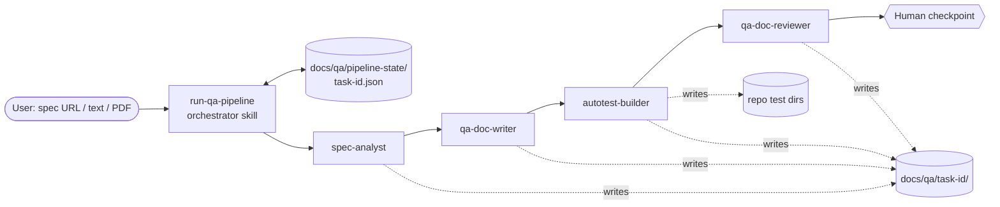
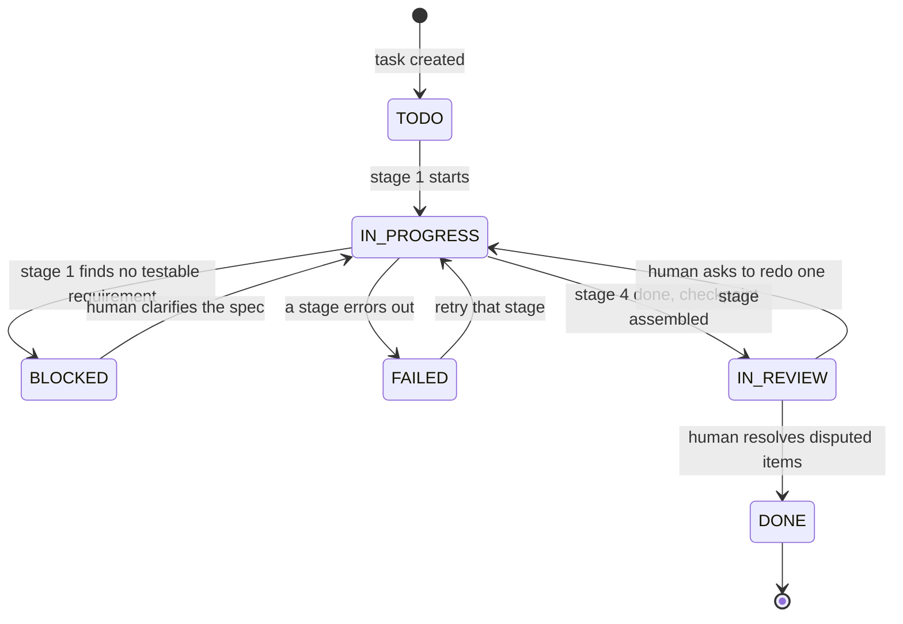

# Architecture and design decisions

This document explains how the plugin is built and, more importantly, why. For what each
stage does step by step, see [pipeline.md](pipeline.md); for the exact file formats, see
the [artifact contract](../skills/run-qa-pipeline/references/artifact-contract.md).

## Building blocks

The plugin uses three Claude Code component types:

| Component | Count | Role |
|---|---|---|
| **Agents** (`agents/*.md`) | 4 | One per pipeline stage. Each has its own persona, tool allowlist, preloaded skills, and explicit "what you do / what you don't do" boundaries |
| **Skills** (`skills/*/SKILL.md`) | 18 | Procedures the agents follow: methods (test design, risk scoring), formats (case anatomy, report layout), and orchestration (run, persist, resume) |
| **Reference files** (`skills/*/references/*.md`) | 29 | Long-form material a skill loads only when needed: templates, catalogs, worked examples, tool payloads |

There is no code that runs inside Claude Code: no hooks, no MCP servers. Everything the
pipeline does, it does through Claude's own tools (Read, Write, Edit, Bash, WebFetch).
The Python in `tools/` is development tooling for this repository — validation and
evals — not part of the installed plugin's behaviour.

## Decision 1 — four specialised agents instead of one long prompt

A single agent asked to "analyse this spec and write tests" collapses four different jobs
into one pass and does each of them worse: it skips analysis to get to cases, writes
cases that mirror the spec's prose, defaults everything to E2E, and then reviews its own
output favourably. Splitting the work gives each stage:

- **a narrow definition of done** — `spec-analyst` must not write test cases;
  `qa-doc-writer` must not write code; `autotest-builder` must not edit product code to
  make a test pass;
- **its own tool allowlist** — the analyst and the reviewer cannot `Edit`; only the
  autotest builder can run arbitrary commands;
- **a fresh context** — each agent reads the previous stage's files, not the previous
  stage's reasoning.

## Decision 2 — the reviewer is independent by construction

`qa-doc-reviewer` re-derives the list of requirements from the original spec
(`spec-source.md`) before it opens the test plan, and compares the two. It never reads
the writer's summary of the requirements as its source of truth. It also re-runs a
sample of tests that Stage 3 reported as passing. This is the difference between
"internally consistent" and "covers the spec".

The same principle shows up inside skills: `ai-test-generation`'s self-review step is
explicitly reassigned to Stage 4, because "the generator reviews its own tests" is the
*closed AI loop* smell in `ai-qa-review`'s catalogue.

## Decision 3 — exactly one human checkpoint, at the end

Stopping for approval between every stage turns an agentic pipeline back into a
copy-paste workflow. Running fully unsupervised hides judgment calls. The compromise:

- the chain runs autonomously; every assumption made to keep moving is **logged**, not
  silently absorbed;
- questions only the spec owner can answer go into a ready-to-forward **Track B** list;
  questions the operator can answer immediately (**Track A**) are asked in the moment;
- the reviewer separates objective defects (Blocking / Major / Minor) from genuine
  **Disputed** judgment calls, states both positions, and does not pick a side;
- the orchestrator assembles a single **Human Checkpoint Report** whose main job is to
  make the Disputed section impossible to miss.

The only mid-chain stop is a spec with no testable requirement at all (`BLOCKED`).

## Decision 4 — progress lives in a file, not in the conversation

A four-stage run can outlast a session: a dropped connection, a daily usage limit, a
closed laptop. `qa-pipeline-task-state` writes a Jira-style task record
(`docs/qa/pipeline-state/<task-id>.json`) before and after every stage. A new session
resumes from the first unfinished stage; an interrupted stage restarts whole (partial
output is never trusted); finished stages are never redone. `BLOCKED` (a content
question for a human) and `FAILED` (a technical error to retry) are different states
because they need different next actions.

## Decision 5 — a machine-checkable artifact contract

Every stage writes markdown a human reads, but with a fixed skeleton a program can parse:

- `REQ-<n>` — numbered requirements from Stage 1, frozen once Stage 2 starts;
- `Q<n>` / `A<n>` — open questions and logged assumptions, marked inline in the spec;
- `TC-<LVL>-<nnn>` — test cases with eight mandatory fields (traces, technique, level,
  priority, preconditions, test data, steps, expected result);
- `R-<n>` — review findings with a severity and a citation.

Because of this, "is every requirement covered?" is answered by
`tools/check_artifacts.py` in milliseconds instead of by a person reading forty cases.
The contract is defined in one file and every skill links to it, so formats cannot drift
between stages; `tools/validate_plugin.py` fails CI if the contract and the skills that
implement it disagree.

## Decision 6 — extend the repository, never compete with it

`autotest-builder` runs `stack-detection-for-autotests` before writing a single test:
the existing runner, test directory, naming convention, fixtures, and page objects are
reused. A repo with Cypress gets Cypress tests; a repo with pytest gets pytest. The
builder works on whatever branch is checked out and never commits, pushes, or opens a
PR — landing the change is the human's decision.

## Decision 7 — one output language per run

Teams write test documentation in their working language. The pipeline resolves English
or Russian once per run (explicit request → project context → existing task → ask →
the spec's own language), stores it in the task file, and applies it to every human-facing
artifact — while identifiers, IDs, file names, and framework keywords always stay in
English, as global code conventions require. See
[`qa-output-standards`](../skills/qa-output-standards/SKILL.md).

## Decision 8 — reuse a proven skill library, but make it part of one system

Ten skills come from [petrkindlmann/qa-skills](https://github.com/petrkindlmann/qa-skills)
(MIT). Copied verbatim, they referenced about twenty skills that were not shipped here
and knew nothing about the pipeline's artifacts. Each was reworked into the procedure of
a specific stage while keeping its methodology — see [skills.md](skills.md) and
[THIRD_PARTY_NOTICES.md](../THIRD_PARTY_NOTICES.md) for what changed in each.

## What the plugin deliberately does not do

- It does not rewrite the spec or answer its own open questions.
- It does not commit, push, or open pull requests.
- It does not change product code, CI configuration, or coverage gates during a run.
- It does not run security scanners (ZAP, Semgrep) unless explicitly asked —
  the security *lens* inside the pipeline works on the spec and the test cases.
- It does not integrate with a live Jira/Linear; the task file imitates that workflow
  locally. TestRail / Xray / Zephyr / Qase are used only when access is provided.
