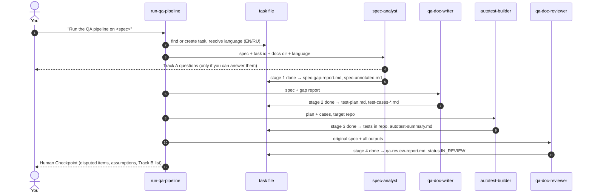

# The pipeline, stage by stage

Every stage reads the previous stage's **files** — never a paraphrase of them — and writes
its own into `docs/qa/<task-id>/` in the target repository. Formats and IDs are defined in
the [artifact contract](../skills/run-qa-pipeline/references/artifact-contract.md).



## Before Stage 1 — orchestration (`run-qa-pipeline`)

1. Compute the task ID: a slug of the spec title plus the first 6 hex characters of the
   SHA-256 of the source, e.g. `checkout-promo-codes-3f9a1c`.
2. If `docs/qa/pipeline-state/<task-id>.json` exists, **resume** instead of starting over.
3. Resolve the output language once and store it in the task file.
4. Read `.agents/qa-project-context.md` if it exists; otherwise use defaults (docs in
   `docs/qa/`, no test-case system, E2E budget 20%, security lens `auto`).

## Stage 1 — spec analysis (`spec-analyst`)

| | |
|---|---|
| **Skills** | `spec-gap-analysis`, `security-testing` (Lens Mode), `risk-based-testing` (orders Track B), `qa-output-standards` |
| **Input** | Spec as URL (fetched), pasted text, or PDF (extracted, with a confidence note if extraction is poor) |
| **Output** | `spec-source.md` (snapshot), `spec-gap-report.md`, `spec-annotated.md` |

What the report contains:

- **Testability score** 1–5 with a one-line reason.
- **Requirements Inventory** — every checkable obligation as `REQ-<n>` with its location
  in the spec, its stated acceptance criterion, and whether it is testable as written.
  This table is the backbone of traceability for every later stage.
- **Blocking gaps** and **contradictions** — each with the exact spec location.
- **Open questions** in two tracks: **A** — the operator can decide now (asked in the
  conversation as found); **B** — only the spec owner can decide (written to be forwarded
  as-is, ordered by the risk of what they block).
- **Assumptions made to proceed** — every gap the pipeline moved past, stated out loud.
- **Security lens** — when the feature touches auth, permissions, input, money, personal
  data, uploads, URLs/webhooks, tenants or admin actions, the spec is checked against
  OWASP Top 10 (2025) questions; every unstated security behaviour becomes a Q or an A.

`spec-annotated.md` is the spec text with markers like `[Q3: TRACK B — …]` at the exact
spot each finding applies, so a human can read the findings in spec order.

**The one allowed stop:** if no acceptance criterion can be derived at all, the task
becomes `BLOCKED` and the pipeline stops with a list of what the spec owner must provide.

## Stage 2 — QA documentation (`qa-doc-writer`)

| | |
|---|---|
| **Skills** | `test-planning`, `risk-based-testing` (Pipeline Mode), `test-design-techniques`, `test-pyramid-strategy`, `test-case-management`, `security-testing` (Lens Mode), `qa-output-standards` |
| **Input** | `spec-source.md` + `spec-gap-report.md` + `spec-annotated.md` |
| **Output** | `test-plan.md`, `test-cases-unit.md` / `-api.md` / `-e2e.md` / `-manual.md` (only levels that have cases), or cases filed into an existing TestRail / Xray / Zephyr Scale / Qase hierarchy |

How cases are produced:

1. **Risk first.** Each REQ gets Impact × Probability (1–5 each) → zone → priority
   P0–P3 → required depth. Open questions about a requirement raise its probability.
2. **Technique per requirement.** Equivalence partitioning, boundary value analysis,
   decision tables, pairwise, state transitions (including illegal transitions),
   security negative cases, or an exploratory charter when nothing formal fits. One case
   per partition, boundary, rule, or transition — not one per requirement.
3. **Lowest sufficient level.** Each case is placed at unit, API, or E2E with a one-clause
   reason; E2E is reserved for journeys whose risk lives in the integration itself, within
   the project's E2E budget.
4. **Eight-field cases**: `TC-<LVL>-<nnn>`, Traces, Technique, Level, Priority,
   Preconditions, Test data, Steps, Expected result — readable by a tester who has never
   seen the feature, in the run's language.
5. **Complete traceability matrix.** Every REQ is covered, out of scope with a reason, or
   blocked by a named Q.

## Stage 3 — autotests (`autotest-builder`)

| | |
|---|---|
| **Skills** | `stack-detection-for-autotests`, `ai-test-generation` (Pipeline Mode), `unit-testing` / `api-testing` / `playwright-automation`, `qa-output-standards` |
| **Input** | `test-plan.md` + case files; the target repository on its current branch |
| **Output** | Test files in the repo's own test directories; `autotest-summary.md` |

1. **Detect the stack** — language, runners, test directories, naming, fixtures, CI.
   Extend what exists; scaffold minimally only if there is nothing.
2. **Design oracles before code** — the case's expected result, plus a negative oracle
   ("what must not happen") and a data oracle when state is persisted.
3. **Write one test per case** (or one parametrized row), titled
   `TC-<LVL>-<nnn>: <case title>` in the output language; identifiers stay in English.
4. **Run them** and record the exact commands, exit codes and per-case status:
   `passed`, `failed` (classified as suspected product defect or test defect),
   `not run` (with exactly what was missing), or `manual`.
5. **Never** change product code to make a test pass, never weaken an assertion to go
   green, never commit or push.

## Stage 4 — independent review (`qa-doc-reviewer`)

| | |
|---|---|
| **Skills** | `qa-doc-review`, `ai-qa-review`, `qa-output-standards` (plus the standards of Stages 2–3) |
| **Input** | The original spec snapshot and every artifact of Stages 1–3 |
| **Output** | `qa-review-report.md` |

1. Re-derive the requirements from `spec-source.md` **before** opening the plan; compare
   with Stage 1's inventory (anything missed is a finding against Stage 1).
2. Check traceability, technique correctness (boundaries really at the boundary, illegal
   transitions present), risk depth for P0/P1, pyramid allocation, security lens, case
   quality (lint), readability and language.
3. Review the autotests: TC ID present, the test asserts the case's expected result,
   reported statuses are true (a sample is re-run), test smells.
4. Rate each finding `R-<n>` as Blocking / Major / Minor, with a citation — or as
   **Disputed** when reasonable QA engineers could disagree, stating both positions.

## After Stage 4 — the Human Checkpoint

`run-qa-pipeline` sets the task to `IN_REVIEW` and writes `checkpoint.md` (abridged illustration):

```markdown
# QA Pipeline — Human Checkpoint
## Task            checkout-promo-codes-3f9a1c · status: IN_REVIEW
## Stage 1         Testability 3/5 · 25 requirements · 18 Track B questions · security lens applied
## Stage 2         41 cases covering 23 of 25 requirements; blocked: REQ-7, REQ-11 (Q1, Q2)
## Stage 3         3 test files · 29 passed · 1 failed (suspected product defect) · 6 not run
## Stage 4         23/25 traced · Blocking 0 · Major 3 · Minor 5
## Everything Assumed Along the Way   …
## Disputed — Needs Your Decision     …
## Next Step       Awaiting your decision on the disputed items.
```

You resolve the disputed items, forward the Track B list to the spec owner, and decide
whether to commit the tests. The task becomes `DONE`, or you ask for one stage to be
redone and only that stage reruns.

## Running a single stage

Each agent can be used on its own — "analyse this spec", "write test cases from this
gap report", "automate these cases", "review this test plan". The same contract applies,
so a later full run can pick the outputs up. `autotest-builder` used on its own still asks
`qa-doc-reviewer` to review what it wrote.
